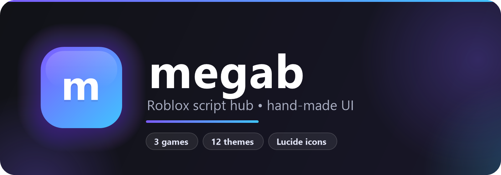
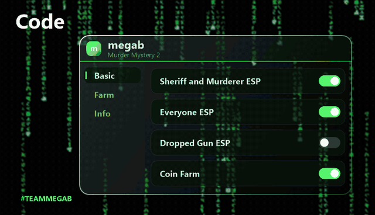
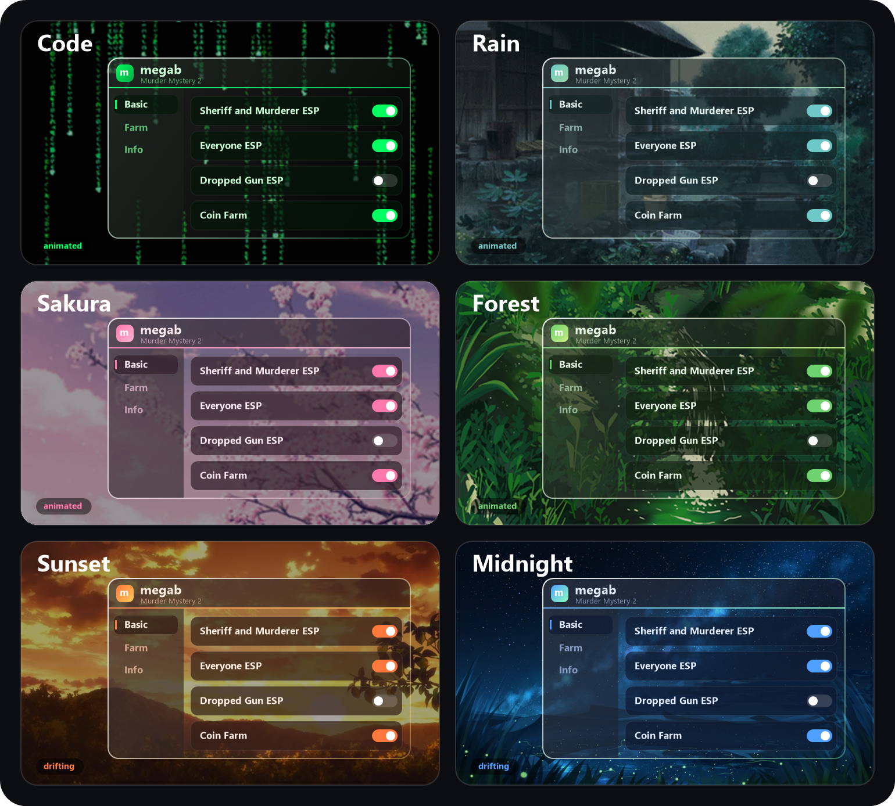
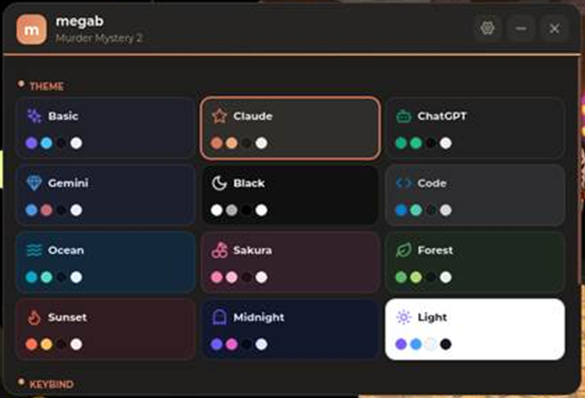

<div align="center">



<br>

<b>A Roblox script hub with a glass UI we built from scratch.</b>
<br>
You run one line. megab finds your game and loads the right features.

<br>


<br><br>



<br>

[Run](#run) • [Use](#use) • [Games](#games) • [Themes](#themes) • [UI](#ui) • [FAQ](#faq)

</div>

<br>

## Run

Paste this into your executor and press Execute.

```lua
loadstring(game:HttpGet("https://raw.githubusercontent.com/aeveloy/megab/main/loader.lua"))()
```

That's it. No setup, no key.

<br>

## Use

<table>
<tr><td align="center"><b>1</b></td><td>Run the line above. A loading screen fills up in about 2 seconds.</td></tr>
<tr><td align="center"><b>2</b></td><td>Pick a tab on the left. Every feature is a switch, slider, dropdown or button.</td></tr>
<tr><td align="center"><b>3</b></td><td>Hide it with the X or RightShift. A small icon waits at the top of your screen. Click it to bring megab back.</td></tr>
<tr><td align="center"><b>4</b></td><td>Open the gear in the top right. Pick a theme and choose your own key.</td></tr>
</table>

megab saves your switches for each game. Your theme and key follow you everywhere.

<br>

## Games

<table>
<tr><th>Game</th><th>What you get</th></tr>
<tr><td><b>Murder Mystery 2</b></td><td>Sheriff and murderer ESP, murderer alert, auto grab gun, coin farm</td></tr>
<tr><td><b>Adopt Me!</b></td><td>Auto pet needs, auto paycheck, teleport menu, anti AFK</td></tr>
<tr><td><b>Prison Life</b></td><td>Team ESP, free guns, auto escape, noclip</td></tr>
</table>

<details>
<summary><b>Every Murder Mystery 2 feature</b></summary>
<br>

The Basic tab
<ul>
<li><b>Sheriff and Murderer ESP</b> makes the murderer glow red and the sheriff glow blue.</li>
<li><b>Everyone ESP</b> makes innocents glow green and puts names above heads.</li>
<li><b>Display Distance</b> shows the role and distance in studs above the murderer and sheriff.</li>
<li><b>Dropped Gun ESP</b> lights up the gun after the sheriff dies.</li>
<li><b>Role Notify</b> tells you who the murderer and sheriff are.</li>
<li><b>Murderer Alert</b> warns you when the murderer gets close. You set the distance.</li>
<li><b>Teleports</b> take you to the murderer, the sheriff or any player you pick.</li>
<li><b>Auto Grab Gun</b> grabs the dropped gun for you.</li>
</ul>

The Farm tab
<ul>
<li><b>Coin ESP</b> lights up every coin on the map.</li>
<li><b>Coin Farm</b> collects coins for you at the speed you set.</li>
</ul>

</details>

<details>
<summary><b>Every Adopt Me! feature</b></summary>
<br>

The Basic tab
<ul>
<li><b>Teleport menu</b> takes you home, to the main map, the school, the hospital and every shop.</li>
<li><b>Speed and jump</b> sliders.</li>
<li><b>Anti AFK</b> stops the idle kick.</li>
</ul>

The Farm tab
<ul>
<li><b>Auto Paycheck</b> collects your paycheck.</li>
<li><b>Auto Pet Needs</b> checks what your pet wants and does it. That covers school, bed, bath, walks, rides, play and more.</li>
</ul>

</details>

<details>
<summary><b>Every Prison Life feature</b></summary>
<br>

The Basic tab
<ul>
<li><b>Team ESP</b> with names and distance.</li>
<li><b>Teleports</b> to the main spots in the prison.</li>
<li><b>Speed, jump and noclip.</b></li>
</ul>

The Guns tab
<ul>
<li><b>Get guns</b> from a dropdown, plus quick buttons for the Remington and the AK.</li>
<li><b>Auto Escape</b> turns you from inmate to criminal in one click.</li>
</ul>

</details>

Playing a game megab doesn't support? You get a tab for each supported game with a Teleport button. megab loads itself again when you land.

<br>

## Themes

You get 12 themes. Colors fade when you switch. Every theme uses the glass look.

<div align="center">

</div>

<br>

<table>
<tr><th>Theme</th><th>Background</th></tr>
<tr><td><b>Code</b></td><td>Matrix rain that moves</td></tr>
<tr><td><b>Rain</b></td><td>A rainy garden that moves</td></tr>
<tr><td><b>Sakura</b></td><td>Falling cherry blossoms</td></tr>
<tr><td><b>Forest</b></td><td>A waterfall that moves</td></tr>
<tr><td><b>Sunset</b></td><td>A golden sky that slowly drifts</td></tr>
<tr><td><b>Midnight</b></td><td>The Milky Way, slowly drifting</td></tr>
<tr><td><b>Claude, ChatGPT, Gemini</b></td><td>Their logo, faint in the corner</td></tr>
<tr><td><b>Basic, Black, Light</b></td><td>Plain glass</td></tr>
</table>

<details>
<summary><b>See all 12 color sets</b></summary>
<br>
<div align="center">

</div>
</details>

<br>

## UI

We wrote it from zero. No Rayfield, no borrowed library.

<ul>
<li><b>Glass.</b> Panels let the background show through. A soft shine sits on top, and the edge glows in your theme color.</li>
<li><b>Lucide icons</b> on tabs, buttons and notifications.</li>
<li><b>Smooth motion.</b> The window bounces open. Switches bounce too. Pages slide and notifications fade.</li>
<li><b>Moving backgrounds.</b> Roblox can't play GIFs, so megab cuts each one into picture sheets and plays them frame by frame.</li>
<li><b>Drag it</b> by the top bar, or shrink it down to the title bar.</li>
<li><b>Your key.</b> Pick any key to open and close it.</li>
</ul>

<br>

## FAQ

<details>
<summary><b>Which executors work?</b></summary>
<br>

Any executor with <code>loadstring</code> and <code>game:HttpGet</code> runs megab.
The backgrounds and logos also need <code>getcustomasset</code> and <code>writefile</code>. Without those you still get every feature. You just don't see the pictures.
</details>

<details>
<summary><b>Where does megab save my stuff?</b></summary>
<br>

Everything lives in the <code>megab</code> folder inside your executor's workspace.
<ul>
<li><code>settings.json</code> holds your theme and key.</li>
<li><code>configs</code> holds your switches, one file per game.</li>
<li><code>assets</code> holds the background pictures. megab downloads each one once, the first time you pick that theme.</li>
</ul>
</details>

<details>
<summary><b>The teleport failed with error 773. Now what?</b></summary>
<br>

Some games block teleports to other games. megab copies the game link to your clipboard. Paste it in your browser and join from there.
</details>

<details>
<summary><b>How do I close it for good?</b></summary>
<br>

Open the Info tab and press Unload hub. Running the loader again also replaces the old window, so you never end up with two.
</details>

<details>
<summary><b>I'm a developer. How do I add a game?</b></summary>
<br>

<ol>
<li>Create a file in <code>games</code> named after the game's GameId, like <code>games/66654135.lua</code>. It returns <code>function(Window, ctx) ... end</code>.</li>
<li>Add tabs with <code>Window:CreateTab</code>, then fill them with toggles, sliders, dropdowns, buttons and text.</li>
<li>Add the game to <code>SUPPORTED</code> in <code>loader.lua</code> and to the games table in this README.</li>
</ol>

You'll find the full rules in <a href="CLAUDE.md">CLAUDE.md</a>.
</details>

<br>

<div align="center">


<h3>made by <a href="https://github.com/aeveloy">@aeveloy</a> and claudecode <3</h3>

<h1>#TEAMMEGAB</h1>

Like it? Give the repo a star.

</div>
